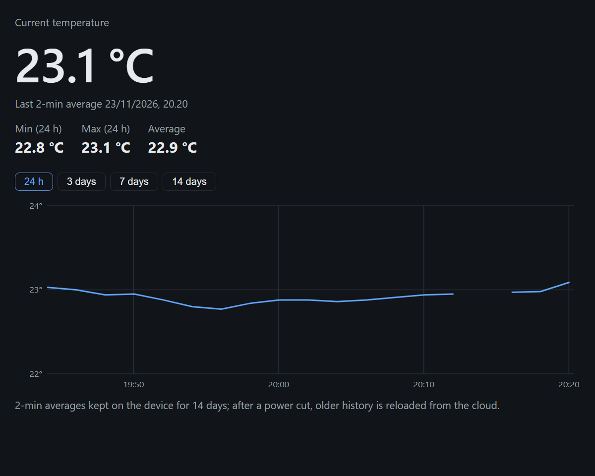
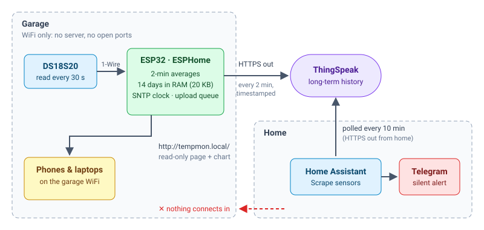
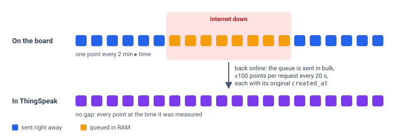
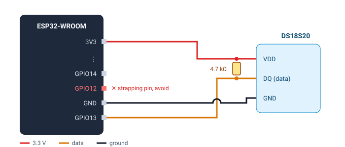
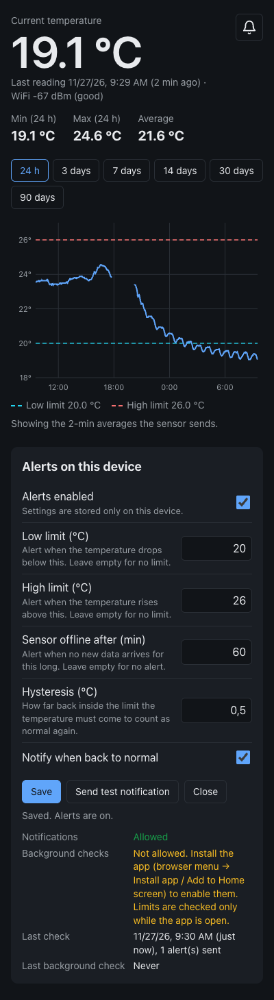

# esp32-remote-temperature-monitor

A temperature monitor for a remote site (cabin, garage, shared space…) built on an
ESP32 and a DS18x20 1-Wire sensor, running [ESPHome](https://esphome.io).

- **Anyone on the site's WiFi** opens `http://tempmon.local/` and sees the current
  temperature plus a 24 h / 3 d / 7 d / 14 d chart. No app, no login.
- **You** get the full long-term history in a [ThingSpeak](https://thingspeak.mathworks.com)
  channel, and from there in Home Assistant (or anything else that can read an HTTP API).
- **Anyone, anywhere** can use the optional [phone app](#phone-app-pwa): a PWA that reads
  the public ThingSpeak channel and alerts when the temperature leaves limits each user sets
  on their own phone.
- **No inbound access needed** at the site: no port forwarding, DDNS, VPN or local server.
  The board only makes outgoing HTTPS requests.



Write-up with background and design notes:
[How to build a remote temperature monitor with ESP32](https://slmnn.fi/posts/how-to-build-a-remote-temperature-monitor-with-esp32/)

## How it works



- The sensor is read every 30 s; four readings are averaged into one point every 2 minutes.
- Each point goes into a 10 080-slot ring buffer in RAM (14 days, 20 KB) that the local web
  page charts, and is sent to ThingSpeak (field 1 = °C, field 2 = WiFi RSSI in dBm).
- After a power loss or reboot, the local history is loaded back from ThingSpeak, which keeps
  everything.
- The chart zooms to the data it has, so a freshly restarted board doesn't show a nearly empty
  24-hour chart.

### Time and outages



- The board syncs its clock over SNTP (`pool.ntp.org`). Every point is stamped with its
  **measurement time** in UTC; the web page shows it in the viewer's local time.
- Uploads use ThingSpeak's
  [bulk-update API](https://www.mathworks.com/help/thingspeak/bulkwritejsondata.html) with
  `created_at`, so ThingSpeak and Home Assistant get the time it was measured, not the time it arrived.
- If the internet or ThingSpeak is down, points stay queued in RAM. When the connection is back
  they go out in batches of 100 every 20 s, still with their original timestamps. Up to the full
  14 days can be caught up, as long as the board isn't rebooted in between.
- Before the first time sync, points are kept but not uploaded. They are dated and sent once
  the clock is set.

### Restoring history after a reboot

A reboot or power cut empties the RAM buffer, so the board loads its older history back
from ThingSpeak:

- It starts once the clock is synced and the first new point exists.
- It fetches `fields/1.csv` in **6-hour windows, newest first**, one request every 10 s
  (~6 KB each), until the 14-day buffer is covered. That takes about 9 minutes.
- Restored points only go into empty slots and never overwrite what the board measured
  itself. The minutes the board was actually off stay as a gap.
- It never blocks anything. The page, measurements and uploads work normally meanwhile, and
  the chart fills in as windows arrive.
- Only one request is in flight at a time. ESPHome's `http_request` is asynchronous, so a
  timer could otherwise queue the same window twice. A window is accepted only if its whole
  body arrived. A failed window is retried with backoff (20 s up to 5 min) and skipped only
  after 12 failures in a row.
- For a **private** channel, set `ts_read_key` in `tempmon.yaml`'s `substitutions`. A public
  channel needs no key.

### Security model

| Thing | Protection |
|---|---|
| Temperature page `/` and `/history.json` | Public on the site LAN, read-only. There are no settings reachable over the network. |
| WiFi settings | Only via the fallback hotspot *Tempmon Setup*, which is WPA2-protected (`tempmon_ap_password`). |
| Firmware updates (OTA) | Password-protected (`tempmon_ota_password`), and only from the same LAN. |
| Long-term data | ThingSpeak channel: **public** (anyone with the channel ID can read it) or **private** (readers need the *Read API Key*). Writing always needs the *Write API Key*. |

## Hardware

- ESP32 dev board with ESP32-WROOM-32 (NodeMCU-32S, DevKitC or similar)
- DS18S20 or DS18B20 temperature sensor (TO-92 or waterproof probe)
- 4.7 kΩ resistor
- USB power supply

### Wiring



| DS18x20 | ESP32 |
|---|---|
| GND | GND |
| VDD | 3V3 |
| DATA | **GPIO13** |
| 4.7 kΩ resistor | between DATA and 3V3 |

> **Don't use GPIO12** (labelled D12, next to GND on many boards), even though it's
> conveniently placed. It's a strapping pin: the 1-Wire pull-up holds it HIGH at reset, which
> switches the flash to 1.8 V and the board won't boot. GPIO13 is right next to it on the
> same GND pin. Other safe choices: GPIO4, 16, 17, 25, 26, 27, 32.

## Setup

### 1. ThingSpeak channel

1. Create a free MathWorks account at <https://thingspeak.mathworks.com>.
2. *Channels → New Channel*. Name it, set **Field 1 = `Temperature`** and **Field 2 = `RSSI`**, then save.
   New channels are private by default. To share the data (charts on ThingSpeak, keyless API
   reads), go to *Sharing → Share channel view with everyone*.
3. On the *API Keys* tab, note the **Write API Key** (used by the board) and the
   **Read API Key** (for Home Assistant, only if the channel stays private), plus the **Channel ID**.

The free tier allows 3 million messages a year (~8 200/day). This sends 720 a day.

### 2. Install ESPHome

Any ESPHome install works (Home Assistant add-on, Docker Device Builder, or CLI). For the CLI:

```sh
python -m venv .venv
# Windows: .venv\Scripts\activate    Linux/macOS: source .venv/bin/activate
pip install esphome
```

### 3. Configure

```sh
git clone https://github.com/artosalminen/esp32-remote-temperature-monitor
cd esp32-remote-temperature-monitor
cp secrets.example.yaml secrets.yaml
```

Fill in `secrets.yaml`:

| Key | What |
|---|---|
| `remote_wifi_ssid` / `remote_wifi_password` | WiFi at the site where the monitor will live |
| `wifi_ssid` / `wifi_password` | A second network, e.g. home, for testing and updates before you deploy |
| `tempmon_ap_password` | Password of the fallback setup hotspot (≥ 8 characters) |
| `tempmon_ota_password` | Password for over-the-air updates |
| `thingspeak_write_key` | ThingSpeak *Write API Key* |
| `thingspeak_channel_id` | ThingSpeak channel ID (the number in the channel URL) |

`secrets.yaml` is git-ignored. Never commit it.

### 4. Flash

First flash over USB:

```sh
esphome run tempmon.yaml --device COM6        # or /dev/ttyUSB0 on Linux
```

If it fails with *"Wrong boot mode detected"* (common on NodeMCU boards whose auto-reset
circuit doesn't work), **hold the BOOT button** while the tool says `Connecting....`, and
release it once writing starts.

After that, updates go over WiFi from a computer on the same network:

```sh
esphome run tempmon.yaml --device tempmon.local   # or the board's IP
```

### 5. Test at home

Watch the log (`esphome logs tempmon.yaml`) for:

- `'Temperature': Got Temperature=23.3°C`: the sensor works
- `IP Address: 192.168.x.y`: WiFi works
- `ThingSpeak: uploaded 1 point(s)` every 2 min: data is arriving (check the channel's *Private View*)

Then open `http://tempmon.local/` (or the IP). The chart fills in as 2-minute points arrive.

### 6. Deploy

Plug the board in at the site. It joins whichever of the two configured networks it can see.
If neither is available (new site, changed password), after 1 minute it opens a hotspot:

1. On a phone, join WiFi **`Tempmon Setup`** with `tempmon_ap_password`.
2. The setup page opens automatically (or browse to `http://192.168.4.1`).
3. Pick the local network and enter its password. The board reboots onto it.

The hotspot reappears whenever the WiFi is lost for more than a minute.

**Tip:** `tempmon.local` (mDNS) works on most phones and computers but not every Android or
router. Reserve a fixed IP for the board in the site router's DHCP settings and put a QR code
with `http://<that-ip>/` on the enclosure.

## Phone app (PWA)

`pwa/` is an optional phone app: a static Progressive Web App that shows the ThingSpeak data the
same way as the board's own page, from anywhere, and lets each user set their own alert limits.
It's plain HTML/JS with no build step and no server of its own: phones read the ThingSpeak API
directly.



### Features

- **Data:** current value, last reading time, WiFi RSSI, min/max/average and a
  24 h / 3 d / 7 d / 14 d / 30 d / 90 d chart. 24 h uses the raw 2-min points. Longer ranges use
  ThingSpeak's server-side `average` (10–240 min), so a download stays under 1 000 points.
  The last 24 h is kept on the phone, so the app opens instantly and works offline.
- **Alerts:** a low limit, a high limit, *sensor offline* after N minutes, and optionally a
  notification when things are back to normal (with hysteresis so it doesn't flap). Each check
  looks at all points measured since the previous check, so a short dip between two checks is
  still caught. The limits are drawn on the chart.
- **Settings stay on the phone** (IndexedDB). No accounts, no server, nothing to administer;
  each user sets their own limits.
- **Free tier friendly:** reads from a public channel don't count toward ThingSpeak's message
  limit. An open app makes about three small requests every 2 minutes and only fetches new
  points; a background check is one request.

### Background checks: what works where

Without a push server, checks while the app is closed rely on
[Periodic Background Sync](https://developer.mozilla.org/docs/Web/API/Web_Periodic_Background_Synchronization_API),
which only Chromium browsers support:

| Platform | While the app is open | While the app is closed |
|---|---|---|
| Android, Chrome / Edge, **installed** app | Every 2 min | Yes, when the browser decides: typically every 1–12 h depending on how much the app is used and on battery saving |
| Android, not installed / Firefox | Every 2 min | No |
| iPhone / iPad (Home Screen app, iOS 16.4+) | Every 2 min | No |
| Desktop Chrome / Edge, installed | Every 2 min | Yes, while the browser is running |

The alert settings show on each device whether notifications are allowed, whether background
checks are active, and when the last (background) check ran. The PWA is fine for "something
is off" alerts; for prompt, guaranteed alerts use [Home Assistant](#home-assistant) or add a
Web Push server.

### Set up your own

The app has no settings in its code. The channel ID is given to the deploy workflow as a
repository variable and written into the published files at build time.

1. **Make the channel public** (*Sharing → Share channel view with everyone*). The app reads
   without a key. A static web app can't keep a Read API Key secret: anything built into it is
   downloaded by every user.
2. **Try it locally:** `cd pwa && python3 -m http.server 8000`, then open
   `http://localhost:8000/?channel=<CHANNEL_ID>`. Service workers and notifications work on
   `localhost`. Without `?channel=` the page says that no channel is configured.
3. **Publish with GitHub Pages** using the included workflow `.github/workflows/pages.yml`:
   1. Fork or push this repository to GitHub.
   2. Add a repository variable **`THINGSPEAK_CHANNEL_ID`** with your channel ID: *Settings →
      Secrets and variables → Actions → Variables → New repository variable*, or
      `gh variable set THINGSPEAK_CHANNEL_ID -b <CHANNEL_ID>`. The workflow stops with an error
      if it is missing.
   3. *Settings → Pages → Build and deployment → Source:* **GitHub Actions**.
   4. Push a change under `pwa/`, or run *Deploy PWA to GitHub Pages* by hand from the
      *Actions* tab. Run it again after changing the variable.

   The app is then at `https://<user>.github.io/<repo>/`, or `https://<your-domain>/<repo>/`
   if your GitHub user site has a custom domain. For a shorter address, put a redirect page at
   the path you want, for example `/tempmon/index.html` on your main site:

   ```html
   <!doctype html><meta charset="utf-8"><title>Tempmon</title>
   <meta http-equiv="refresh" content="0; url=/<repo>/">
   <a href="/<repo>/">Open Tempmon</a>
   ```

   **Other static hosts** work too, as long as they serve HTTPS; all paths are relative. Copy
   `pwa/` and replace `__THINGSPEAK_CHANNEL_ID__` in `core.js` with your channel ID, as the
   workflow does.
4. **Updating:** after changing app files, bump `VERSION` in `pwa/sw.js` so installed apps
   fetch the new version (they switch to it on the next launch).

### Using it

1. Open the app's address on the phone.
2. **Install it:** on Android, browser menu → *Install app* (or *Add to Home screen*). On
   iPhone, *Share → Add to Home Screen* and open it from there; iOS only allows notifications
   for Home Screen apps.
3. Tap the bell, turn **Alerts enabled** on, set the limits and press **Save**. Allow
   notifications when asked. *Send test notification* checks that they arrive.

## Home Assistant

Home Assistant can't reach the board directly, so it reads from ThingSpeak instead. The
**Scrape** integration does this entirely in the UI, with no YAML.

**1. Add the integration:** *Settings → Devices & services → Add integration → Scrape*.
For the resource, use:

```
https://api.thingspeak.com/channels/<CHANNEL_ID>/feeds.xml?results=1
```

- **Public channel:** no API key is needed.
- **Private channel:** append `&api_key=<READ_API_KEY>`.

Scrape reads XML/HTML, not JSON, so use `feeds.xml`, not `feeds.json`.

**2. Add one sensor per value:** use the integration's *Add entity* button:

| Name | Select | Device class | State class | Unit |
|---|---|---|---|---|
| Tempmon temperature | `feed field1` | Temperature | Measurement | °C |
| Tempmon WiFi signal | `feed field2` | Signal strength | Measurement | dBm |
| Tempmon last measurement | `feed created-at` | Timestamp | – | – |

**3. Refresh rate:** Scrape polls every 10 minutes by default. HA stores the newest point at
each poll; it can't import the 2-minute points in between. Requesting more `results` doesn't
help, since only one value per sensor is used. The full-resolution data stays in ThingSpeak and
on the board's own page.

**4. Charts:** add a *History graph*, *Statistics graph* or tile *trend graph* card.
`Tempmon last measurement` is useful for an alert when the board stops reporting.

**Alternative with YAML access:** a `rest` sensor on `.../fields/1/last.json`.

## Local endpoints

| Path | Returns |
|---|---|
| `/` | The HTML page (works offline, no external scripts) |
| `/history.json` | `{"now":22.75,"t":1795456465,"age":42,"step":120,"unsent":0,"restore":2,"restored":512,"heap":169104,"v":[2288,2280,null,…]}`. `v` holds 2-min averages in °C × 100, oldest first, `null` = no reading. `t` is the UTC epoch of the newest point (`0` before the first time sync). `age` is seconds since that point. `unsent` is the number of points waiting for upload. `restore` is `0` waiting, `1` loading history from ThingSpeak or `2` done; `restored` is how many points were loaded back. `heap` is free memory in bytes (diagnostics). |

## Customising

- **Resolution / length of local history:** `STEP_S` and `HIST_N` in `tempmon_web.h`, and
  the matching `interval:` in `tempmon.yaml`. Each point costs 2 bytes. Around 40 000 points
  (80 KB) is a sensible maximum on an ESP32 that also runs WiFi and HTTPS.
- **Read interval:** `update_interval` of the `dallas_temp` sensor.
- **Different pin:** `one_wire → pin`.
- **Several sensors:** add more `dallas_temp` entries with `address:` (shown in the boot log).

## Files

| File | Purpose |
|---|---|
| `tempmon.yaml` | ESPHome device configuration |
| `tempmon_web.h` | Ring buffer, public web page and JSON endpoint (C++ include) |
| `secrets.example.yaml` | Template for `secrets.yaml` |
| `pwa/` | Phone app (PWA): page, service worker, manifest, icons |
| `.github/workflows/pages.yml` | Publishes `pwa/` to GitHub Pages |
| `docs/images/` | Diagrams and screenshot used in this README |

## License

MIT, see [LICENSE](LICENSE).
